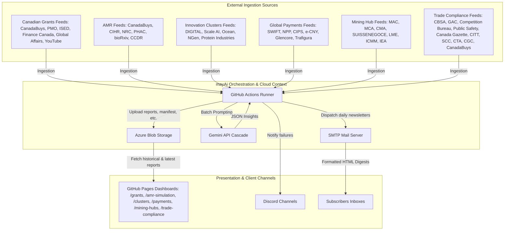
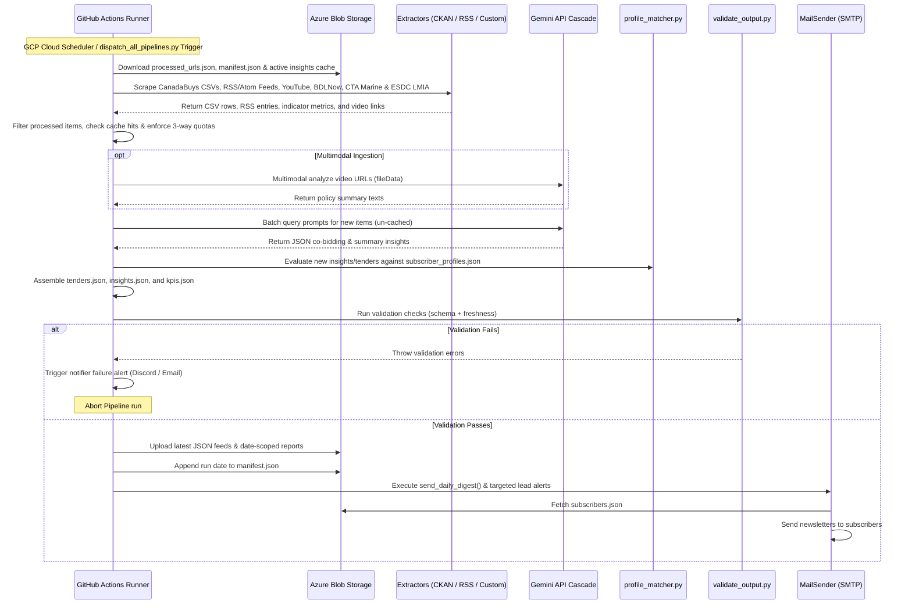

# Canadian Grant Intelligence 2.0 — arc42 Architecture Documentation

This document describes the software architecture of the Canadian Grant Intelligence platform version 2.0 (mayAi).

---

## 1. Introduction and Goals

### 1.1 Requirements Overview
The Canadian Grant Intelligence platform (mayAi) is a high-fidelity monitoring and synthesis pipeline. It continuously scrapes federal and provincial procurement portals, grant databases, political communication channels, and international mining reports to deliver daily intelligence digests to business analysts, co-bidders, and decision-makers.

Key features:
- **Canadian Grants (`13 sources`)**: Scrapes CanadaBuys CSV databases, PMO announcements, ISED Atom feed & GC Business Insights newsletter, Finance Canada, Global Affairs, ECCC, PCO, CRTC, IAAC, CTA Coasting Trade notices, Chamber of Commerce BDL Nowcast macroeconomic indicators, and Prime Minister YouTube channel video updates.
- **Health-Tech & Biotech Simulation (`8 sources`)**: Scrapes CanadaBuys, CIHR, NRC, PHAC, Health Canada MedTech, bioRxiv Microbiology, PHAC Public Health Updates, and PHAC CCDR feeds.
- **Innovation Clusters (`27 sources`)**: Scrapes DIGITAL, Scale AI, Ocean Supercluster (including Blue Economy), NGen, Protein Industries (including Food Security, Agri-Food Federal, and CanadaBuys), Canadian Tech/AI Ecosystem (BetaKit, Cohere/Mila/Vector), Space & Defence (CSA, DND, Defence Primes), and Energy/CleanTech feeds.
- **Global Payments (`13 sources`)**: Scrapes multi-lingual (EN, ZH, FR, DE) ISO 20022/SWIFT, NPP, CIPS, e-CNY, Swiss commodity trade finance, BIS Official Press, US Federal Reserve (FedNow/Fedwire), Bank of England (CHAPS), and SWIFT Official News across CA, AU, CN, HK, CH, UK, and Global hubs.
- **Mining Hubs (`25 sources`)**: Scrapes global mining reports, geological surveys, patents (CIPO), strategic stockpiles (US DLA), lithium registries (Chile MinMinería), and infrastructure corridors (Lobito) across 6 major hubs (Canada, Australia, China, Switzerland, Africa, and UK/Global) and 6 ecosystem water-cycle stages.
- **Trade & Supply Chain Compliance (`17 sources`)**: Scrapes operational feeds across CBSA, Global Affairs Canada, Competition Bureau, Public Safety Canada, Canada Gazette, TCS, CITT, SCC, CTA (Freight & Coasting Trade Marine Notices), CGC, ISED Investment Canada Act (ICA), CRTC, ESDC Positive LMIA approvals, IAAC Major Projects, and CanadaBuys logistics tenders.
- Synthesizes complex regulatory updates into strategic hooks using LLMs and matches high-scoring tenders/signals against subscriber profiles for targeted B2B lead alerts.
- Publishes daily reports to public dashboards and automatically distributes formatted HTML newsletters to email subscribers.

### 1.2 Quality Goals
1. **Robustness & Reliability**: Zero silent errors. All execution failures must trigger immediate alerting via Discord Webhooks and SMTP.
2. **Data Consistency**: Automated output validation using schema checks and freshness controls prevents corrupt or empty reports from corrupting the production dashboard.
3. **Auditable Archives**: Complete execution history, enabling historical date browsing through date-scoped reports in Azure Blob Storage using a date manifest architecture.
4. **Environment Isolation**: Standardized execution via Docker containers, eliminating host dependency differences and Playwright startup snags.

### 1.3 Stakeholders & Personas
- **Operational Administrator**: Needs visibility into scraping statuses, rate-limit failures, and SMTP dispatch failures.
- **B2B Co-bidder**: Requires access to synthesized post copy and strategic recommendations to form bidding consortiums.
- **Business Advisor / Subscriber**: Expects a clean, daily, morning email containing actionable grants and RFPs.

### 1.4 Architecture Documentation Index
The platform's architecture is documented across 9 modular `arc42` specifications:

| Document | Architectural Scope | Topic ID / Status | Configured Sources |
| :--- | :--- | :--- | :--- |
| [architecture_arc42.md](file:///c:/dev/canadian-grant-intelligence/docs/architecture_arc42.md) | Master Platform & Generic Engine | Core Platform (v2.0) | 103 total across 6 Skills |
| [architecture_arc42_grants.md](file:///c:/dev/canadian-grant-intelligence/docs/architecture_arc42_grants.md) | Canadian Grants Intelligence | `canadian-grants` | 13 sources |
| [architecture_arc42_amr_simulation.md](file:///c:/dev/canadian-grant-intelligence/docs/architecture_arc42_amr_simulation.md) | Health-Tech & Biotech Simulation | `amr-simulation` | 8 sources |
| [architecture_arc42_clusters.md](file:///c:/dev/canadian-grant-intelligence/docs/architecture_arc42_clusters.md) | Global Innovation Clusters | `innovation-clusters` | 27 sources |
| [architecture_arc42_payments.md](file:///c:/dev/canadian-grant-intelligence/docs/architecture_arc42_payments.md) | Global Payments & Settlement | `payments` | 13 sources |
| [architecture_arc42_mining_hubs.md](file:///c:/dev/canadian-grant-intelligence/docs/architecture_arc42_mining_hubs.md) | Global Mining Hubs Intelligence | `mining-hubs` | 25 sources |
| [architecture_arc42_trade_compliance.md](file:///c:/dev/canadian-grant-intelligence/docs/architecture_arc42_trade_compliance.md) | Canadian Trade & Supply Chain Compliance | `trade-compliance` | 17 sources |
| [arc42_future_skills_evaluation_engine.md](file:///c:/dev/canadian-grant-intelligence/docs/architecture/arc42_future_skills_evaluation_engine.md) | ESDC Future Skills Evaluation Engine (`#100032488`) | Standalone SOW System | 4 XML Sitemaps (1,351 URLs) |
| [architecture_arc42_retired.md](file:///c:/dev/canadian-grant-intelligence/docs/architecture_arc42_retired.md) | Legacy Monolithic Pipeline (v1.0) | `[RETIRED]` Archive | Historical |

---

## 2. Architecture Constraints

- **Execution Context**: The scraper pipeline must run inside a containerized job on the cloud to avoid local execution issues and rate limits.
- **Persistence**: Zero-database local persistence; all state management (tenders lists, processed URLs, subscriber indexes) relies on Azure Blob Storage JSON files.
- **Frontend Constraints**: Static HTML/CSS/JS frontend hosted on GitHub Pages with zero server-side compilation, pulling data asynchronously from Azure.

---

## 3. System Context and Templates



---

## 4. Solution Strategy

The platform orchestrates the high-fidelity intelligence pipeline via dispatches triggered by external Google Cloud Scheduler HTTP POST jobs running daily or 3x daily directly to the GitHub repository API, which triggers GitHub Actions runners. Native GitHub Actions cron schedule sections are kept commented out in all workflows as a local fallback. The Azure Container Apps Job is kept on standby as a manual override option to ensure operational resilience and zero infrastructure loss.

Key strategies include:
- **Agentic Decoupling via Skills Registry**: Decoupling the orchestrator runtime (Generic Engine) from the domain logic (configured as "Skills" consisting of JSON configuration files, prompt templates, and anchors seed datasets). This makes the platform self-describing, enabling autonomous agents to register and run pipelines without modifying the runtime code.
- **Fast RSS/Atom Extraction**: Utilizing lightweight Python RSS feed parsers to read news feeds concurrently, minimizing the pipeline's execution footprint.
- **Playwright Integration**: Running headless Chromium inside the runner environment solely for generating dynamic social card images, utilizing caching for fast startup times.
- **Incremental Scraping**: Maintaining state via `processed_urls.json` in Azure to scrape and synthesize only new tenders.
- **Self-Healing News Cache**: Running news extraction against the active `pmo_insights.json` cache to automatically reuse insights, heal missing items, and prune expired content.
- **Date-Scoped Historical Partitioning**: Backing up each day's run to `reports/tenders_YYYY-MM-DD.json` and indexing dates in `manifest.json`.

---

## 5. Building Block View

### 5.1 Scraper Pipeline Components (generic_engine/)

The scraping and synthesis engine is built as a generic, configuration-driven multi-topic processor:

```
generic_engine/
├── main.py                    # Orchestrates extraction, analysis, validation, and upload
├── schema.py                  # Pydantic V2 schemas validating configs (PipelineConfig)
├── models.py                  # Dataclass schemas for Tenders, Insights, and KPIs
├── extractors/
│   ├── bdlnow.py              # Chamber of Commerce BDL Nowcast macroeconomic indicator scraper
│   ├── ckan.py                # Interacts with CanadaBuys CKAN API for CSV files
│   ├── cta_marine.py          # Canadian Transportation Agency coasting trade / marine notice extractor
│   ├── esdc_lmia.py           # Open Government CKAN Positive LMIA quarterly dataset extractor
│   ├── ised_newsletter.py     # ISED GC Business Insights newsletter scraper
│   ├── playwright_scraper.py  # Headless browser crawler for JS-rendered news feeds
│   ├── report_scraper.py      # Parses PDFs and documents for slow-moving anchors
│   ├── rss.py                 # Fetches and parses RSS/Atom feeds with dynamic keyword parameters
│   └── youtube.py             # Scrapes YouTube channel videos tab
└── api/
    ├── azure_client.py        # Wrapper for Azure Blob Storage with auto-bootstrap checks
    ├── gemini_client.py       # Batch querying wrapper for Gemini LLM cascade
    ├── notifier.py            # Failure notification and HTML digest SMTP mailer (Discord + Email)
    └── profile_matcher.py     # Profile-aware B2B lead alert and co-bidding matcher
```

- **main.py**: The orchestrator. Coordinates feed scraping across all specialized extractors, deduplication, 3-way quota enforcement, LLM synthesis, profile-aware lead alert matching, date manifest compilation, and uploads to Azure Blob Storage.
- **schema.py**: Enforces strict Pydantic V2 configuration schemas (supporting parameters like `manifest_file`, per-hub/per-stage quotas, source overrides, and metadata) to allow running all 6 domain pipelines under the same orchestrator.
- **profile_matcher.py**: Evaluates newly synthesized tenders and policy signals against subscriber profiles (`configs/subscriber_profiles.json`) using weighted keyword, NAICS/sector, province, and playbook rules to trigger targeted B2B lead alerts.
- **notifier.py**: Handles error alerts (Discord/Email) and compiles/dispatches the daily HTML digest newsletters and targeted profile lead alerts to subscribers.
- **scripts/validators/validate_output.py & scripts/validate_skill.py**: Validate runtime output JSON schemas/freshness and configuration compliance prior to cloud upload.

### 5.2 Skills Registry Infrastructure

The Skills Registry layer structures pipeline governance:
- **Skill Isolation**: Topic domains are configured as self-contained "Skills" located in `configs/` containing dynamic parameters, target containers, active keywords, and prompt instructions.
- **Anchor Lifecycle Decoupling**: Static reference databases (e.g. `grants_anchors.json`, `hub_anchors.json`, `trade_anchors.json`) are decoupled from code. The orchestrator tracks and alerts when an anchor fact has exceeded its `review_by` metadata date.
- **Verification Harness**: Standardized diagnostics run via `scripts/validate_skill.py` to ensure new configurations satisfy strict schema parameters prior to deployment.

---

## 6. Runtime View

### 6.1 Daily Orchestration Flow



### 6.2 News & Insights Data Flow (Multi-Topic)

All news and insights dashboard sections (e.g., PMO News, Innovation Clusters, Global Payments, Global Mining Hubs, and Trade Compliance) are processed dynamically via the config-driven runtime:
1. **Extraction**: `main.py` orchestrates `rss.py`, `ckan.py`, `bdlnow.py`, `cta_marine.py`, `esdc_lmia.py`, `ised_newsletter.py`, `youtube.py`, and `playwright_scraper.py` to ingest new announcements from configured domains.
2. **Caching & Deduplication**: The active insights file (e.g., `pmo_insights.json` or `mining_insights.json`) acts as the cache. Links in the active feeds are matched against this cache; if found, their insights are reused directly to bypass Gemini. If not, they are passed to the Gemini Client for duplicate clustering and analysis.
3. **AI Synthesis**: Uncached items are packaged and sent to `gemini_client.py` where the LLM resolves strategic value B2B hooks and classifications, grounding the output against the slow-moving anchor database.
4. **Cloud Storage & Manifesting**: The generated insights and executive post are stored in Azure Blob Storage. The run date is compiled into the `manifest.json` file.
5. **Client-Side Historical Rendering**: When the user changes the "Archive" dropdown in the static dashboard UI, vanilla JavaScript dynamically fetches the manifest, resolves the date-scoped JSON paths from Azure, and updates the layout dynamically.

---

## 7. Deployment View

- **Pipeline Execution**: The daily pipelines are triggered externally by Google Cloud Scheduler HTTP POST jobs (and `scripts/dispatch_all_pipelines.py`) dispatching directly to the GitHub repository API, running inside `ubuntu-latest` runner environments via `.github/workflows/run_pipeline.yml` with Playwright caching enabled for social card generation. Native GitHub Actions cron blocks are kept commented out as a fallback.
- **Standby Container Job**: The Azure Container App Job configuration, Dockerfile, and container image are preserved in a dormant status. The trigger type is configured to `Manual` to prevent redundant billing while keeping the containerized path immediately ready for re-activation.
- **Frontend Hosting**: Static GitHub Pages sites resolve requests using raw JSON paths from the public Azure Blob container URLs (`data`, `amr-simulation-data`, `clusters-data`, `payments-data`, `mining-hubs-data`, `trade-compliance-data`).

---

## 8. Concepts

### 8.1 Automated Data Verification
The system enforces strict data verification via `scripts/validators/validate_output.py` and the internal engine validator. If any check fails, the pipeline execution is immediately aborted, protecting the production dashboard from corrupted states:
- **File Completeness**: Verifies presence of required insights, tenders, and KPI JSON files.
- **JSON Structure**: Assures structural format constraints (e.g. tenders root is an Array; KPIs are typed Integers and Strings).
- **Freshness Control**: Checks the KPI `generated_at` timestamp. If the runtime is older than the configured threshold (e.g. 2 hours), the run is aborted.

---

## 9. Design Decisions

- **Zero-Database JSON Architecture**: Storing structured datasets as raw JSON files in Azure Blob allows the frontend to run entirely serverless, reducing maintenance costs.
- **State-Based Date Dropdown**: Storing historical run dates in a simple sorted array in `manifest.json` enables the frontend to lazily load and present a dropdown list of historical dates without hitting API rate limits.
- **Individual SMTP Dispatching**: Sending individual emails rather than CC-ing subscribers prevents recipient email leakage and aligns with privacy regulations.
- **Algorithmic Pacing (Throttling)**: The extraction orchestrator enforces strict geometric pacing to guarantee execution requests mathematically never exceed the primary model's Requests Per Minute (RPM) ceiling (e.g., 15 RPM).
- **Batch Processing Pipelines**: To aggressively protect low RPM limits while maximizing high Tokens Per Minute (TPM) limits, input text is grouped and transmitted in unified batch arrays. The model enforces structured JSON output schemas to return parallel arrays of insights.
- **Model Waterfall (Fallback Strategy)**: The LLM client implements a tiered routing pattern. If the primary model (`gemini-flash-latest`) is rate-limited or exhausts its daily quota, the client traps the exception and dynamically pivots the payload through fallback models (`gemini-flash-lite-latest` $\rightarrow$ `gemini-3.8-flash` $\rightarrow$ `gemini-3.7-flash` $\rightarrow$ `gemma-4-31b-it`), which utilize separate quota pools and evergreen dynamic pointers.
- **Profile-Aware B2B Lead Alert System**: Rather than relying solely on broadcast digests, `profile_matcher.py` scores incoming tenders and signals against structured subscriber profiles (`subscriber_profiles.json`) to automatically flag high-fit co-bidding and consulting opportunities.
- **Self-Healing News Cache**: Using the live insights JSON file as the cache, allowing missing or corrupted items to automatically heal and old ones to prune natively, bypassing the restrictive `processed_urls.json` filter.
- **Feed Failure Resilience**: Tracking individual RSS feed statuses during parsing. If a feed source fails, the system automatically retains all existing insights belonging to that source, preventing data loss due to temporary network or server outages.
- **Self-Healing Storage Bootstrapping**: Azure storage containers (such as `mining-hubs-data` and `trade-compliance-data`) are verified and dynamically created with public blob access on first pipeline upload. This removes manual container creation tasks and guarantees zero-downtime deployment in new clouds.
- **Search Redirect Fallback for Private/Ariba Feeds**: Custom Ariba-imported notices in CanadaBuys (which lack public HTML pages and cause 404/403 errors when linked directly) are dynamically intercepted in the parser and rewritten as public search redirect queries (using the solicitation number). This enables users to access the opportunity files directly from the dashboard without encountering authentication walls.
- **Shared Multi-Topic Ingestion Architecture**: Standardizing on a generic Pydantic config-driven architecture (`generic_engine/`) rather than individual hardcoded pipelines increases code reuse, ensures consistent telemetry metrics, and eases onboarding of new topic categories.
- **Exclusion of Gemstone & Luxury Hubs**: Specific gemstone trading and extraction hubs (e.g., Antwerp, Botswana, or South American gemstone mines) are excluded due to supply chain divergence (luxury consumer goods vs. industrial green-tech), data feed fragmentation (predominantly artisanal and un-structured ASM mining), and lack of alignment with B2B industrial grant and consortium frameworks.
- **Structured Prompt Decomposition**: Factoring out persona, classification, grounding, translation, and output formatting rules from the monolithic `system_instruction` into structured configuration fields. This enables granular testing, prompt engineering isolation, and prevents LLM drift across runs.
- **Skill Versioning**: Incorporating explicit `skill_version` and `schema_version` fields in KPIs and telemetry outputs to audit pipeline compliance and monitor configuration schema migrations over time.
- **Container-Aware URL Pruning**: Standardizing URL registry pruning into a container-aware task (`scripts/validators/prune_processed_urls.py`) that reads storage targets dynamically from the active Skill's config path, ensuring all pipelines benefit from bounded growth.

---

## 10. Skills Registry Governance

The Canadian Grant Intelligence 2.0 platform governs all 6 operational pipelines under a unified Skills Registry contract:
- **Skill Boundary**: Each domain pipeline is isolated into a declarative JSON configuration (`configs/<skill>.json`) and a companion statutory/industry anchor seed database (`configs/<skill>_anchors.json`).
- **Harness Boundary**: The shared runtime engine (`generic_engine/`) and verification scripts (`scripts/validate_skill.py`, `scripts/validators/validate_output.py`, `scratch/audit_arc42.py`) enforce schema compliance, quota equilibrium, Azure Blob persistence, and per-container subscriber isolation (`subscribers.json`).

